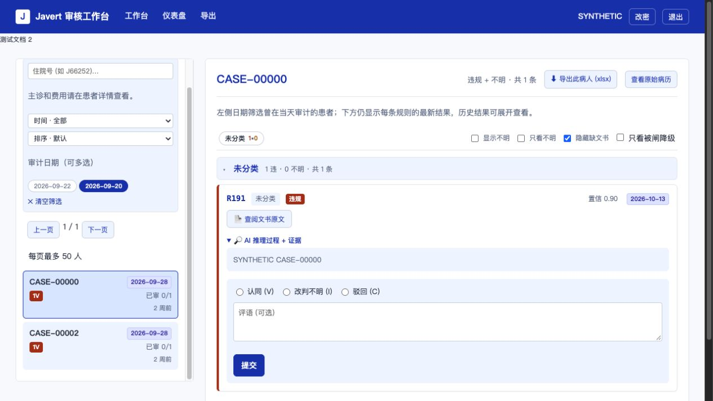

# v2 验证范围

最终相关组合：228 collected / 228 passed / 0 failed / 0 skipped / 0 errors；另有30项Node测试全部通过。覆盖性能、工作台/API/鉴权/原文、LIS、日期、旧/新安装器、故障恢复、回滚、锁、运行环境和监测context保持；不是全仓测试声明。

首次日期兼容组合为227 collected / 226 passed / 1 failed / 0 skipped / 0 errors。唯一失败是旧模板测试仍要求随机tag，按已安装日期合同改为日期断言。随后新增历史说明预览回归，先复现空值，再保留401字展示片段，最终得到上述228项结果。

本包从gnome-243独立移植通用性能片段，不整文件覆盖主干或62代码。旧性能v1包的13项SHA全部匹配；v1清单、安装器和实际Releases文件一致，旧包不改写。用户确认院内已安装日期补丁，其36项摘要也全部通过；v2以该日期版本为唯一安装起点。

运行payload共9文件：sqlserver_store、routes_workbench、app.js、_sidebar、_patient_cards，以及main、hit_resolver、patient_detail、workbench。前5项覆盖原性能v1，后4项和相交文件补齐压缩、费用复用、导航与详情缓存。

不包含62来源profile业务路径：院内代码没有这次标签查询，不为缓存额外添加SQL。院内费用命中/无匹配回退、锚点缓存、上海取数、LIS分区、原文全量接口及30秒缓存保持原语义。没有依赖升级或数据库迁移。

构建基线、测试结果和现场限制见仓库`docs/deployment_249_web_performance.md`及本包`manifest.json`。本地合成测试与文件安装演练不能证明医院机器已安装或进程已加载；用户需按README完成现场验收。

日期依赖models.py、templating.py、batch_dates.py与已交付日期包逐字一致，只在维护分支登记，不作为新增功能上传。实际payload不包含这三个文件，安装前检查其日期版摘要。监测适配只接受9文件的已知性能变化，完整校验其余运行文件；保留日期版四个watch文件原字节及原context，安装和回滚均不迁移SQLite账本。

医院历史模板仍显示前400字说明，因此历史查询保留401字用于显示与省略号判断，不再把这段可见内容置空；大工具记录仍只返回最新主卡。先红回归证明旧精简会丢这段内容。

本地合成页面验证：日期筛选2/4，上海全局费用筛选隐藏，A→C→A的Document和A响应标记均保持2，日期选择及提示保持。

